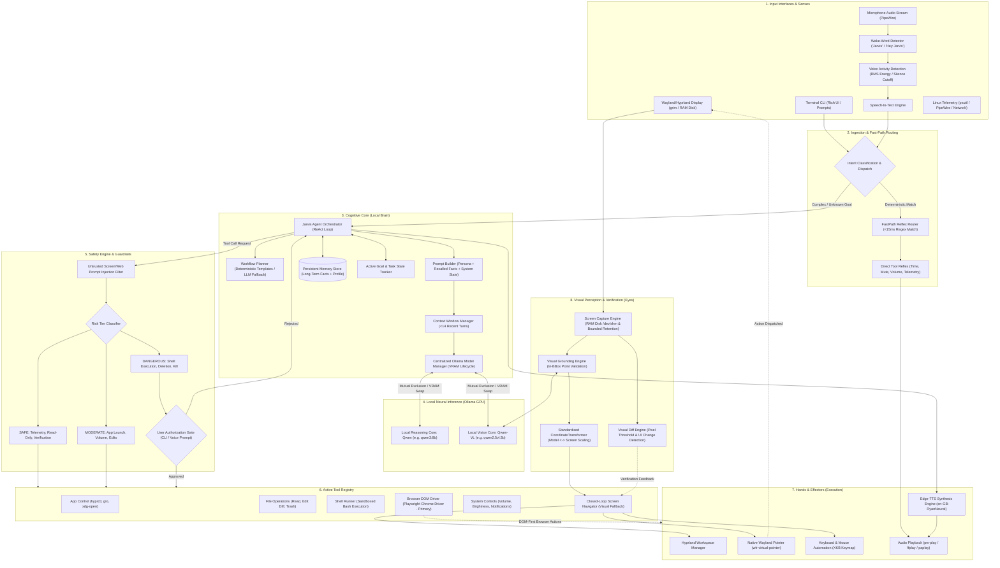
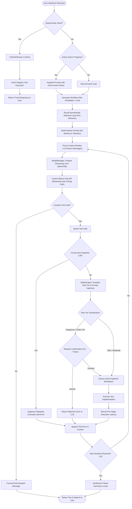

# Project J.A.R.V.I.S. – System Architecture

> **Just A Rather Very Intelligent System**  
> An autonomous, 100% local-first desktop AI agent designed for Linux/Wayland (Hyprland) environments to perceive screen state, control input devices, manage applications, run system workflows, and communicate through natural voice.

---

## 1. High-Level System Architecture

The following flowchart illustrates the end-to-end architecture of the J.A.R.V.I.S. ecosystem, spanning **Sensory Ingestion**, **Cognitive Reasoning & Planning**, **Safety Gates**, and **Effectors & Environmental Control**.

---

## 2. ReAct Cognitive Loop & Decision Pipeline

The central reasoning engine executes an iterative **Reason + Act** cycle with deterministic fast-path routing, context pruning, tool deduplication, and visual feedback collection.

---

## 3. Closed-Loop GUI "Computer Use" Workflow

For graphical user interface automation, J.A.R.V.I.S. prioritizes **DOM/Accessibility-first** interaction when controlling browsers, falling back to a robust closed-loop **Observe ➔ Locate ➔ Act ➔ Verify** visual pipeline for desktop apps.

```mermaid
flowchart LR
    subgraph Step1 ["1. Observe"]
        Capture["ScreenCaptureEngine (grim)"]
        RAMDisk["Save to /dev/shm (or /tmp) with max_frames=20"]
        Capture --> RAMDisk
    end

    subgraph Step2 ["2. Locate"]
        VLMManager["ModelManager: Load Vision Core (qwen2.5vl:3b)"]
        VLM["Ollama Vision Model"]
        Parser["Parser: Independent BBox & Point Extraction"]
        Transformer["CoordinateTransformer (Model Scale -> Screen Resolution)"]
        RAMDisk --> VLMManager
        VLMManager --> VLM
        VLM --> Parser
        Parser --> Transformer
    end

    subgraph Step3 ["3. Act"]
        FocusWS["Switch & Verify Hyprland Workspace"]
        SafetyCheck["Verify Point Strictly Inside Bounding Box"]
        PointerDispatch["Dispatch Action (wlr-virtual-pointer / PyAutoGUI)"]
        Transformer --> FocusWS
        FocusWS --> SafetyCheck
        SafetyCheck --> PointerDispatch
    end

    subgraph Step4 ["4. Verify"]
        PostCapture["Post-Action Capture (persistent=False)"]
        DiffEngine["VisualDiffEngine (pixel_threshold=15 Filtering)"]
        StateCheck{"UI Changed?"}
        PointerDispatch --> PostCapture
        PostCapture --> DiffEngine
        DiffEngine --> StateCheck
    end

    StateCheck -- Yes --> SuccessOutcome(["Action Confirmed Successful"])
    StateCheck -- No --> Recover(["Report Failure: Suppress Dangerous Clicks"])
```

---

## 4. Subsystem Breakdown & Tech Stack

| Subsystem | Key Modules | Primary Technologies | Key Functions & Responsibilities |
|---|---|---|---|
| **Voice In** | `voice/wake_word.py` `voice/listener.py` | PipeWire (`pw-record`), Whisper STT, RMS Energy VAD | Wake-word detection ("Jarvis"), voice activity detection, streaming speech-to-text pipeline. |
| **Voice Out** | `voice/speaker.py` | Microsoft Edge-TTS (`en-GB-RyanNeural`), `pw-play` / `ffplay` | British gentleman speech synthesis, streaming sentence pipelining, instant barge-in cut-off. |
| **Cognitive Core** | `core/agent.py` `core/fast_path.py` `core/prompts.py` | Python 3, Pydantic, Custom ReAct Loop, Deterministic Workflow Templates | Orchestrates reasoning, maintains active goal tracking, token context pruning, reflex execution routing. |
| **Model Manager** | `core/model_manager.py` `core/llm_client.py` | Local Ollama API, Centralized Residency Manager | Exclusive VRAM residency on laptop GPUs (RTX 3050 4GB), mutual exclusion between reasoning and vision, configurable idle timeout. |
| **Perception (Vision)** | `vision/capture.py` `vision/coordinates.py` `vision/grounding.py` `vision/analyzer.py` `vision/visual_diff.py` | `grim` (Wayland), Pillow, Qwen 2.5-VL via Ollama | Zero-disk-I/O RAM screenshot capture with bounded retention (20 frames), bidirectional coordinate scaling/clamping, pixel-thresholded UI diff detection. |
| **GUI Automation** | `gui_driver/navigator.py` `gui_driver/mouse_keyboard.py` `core/workspace.py` | Wayland `wlr-virtual-pointer`, PyAutoGUI, `hyprctl` | Smooth cursor motion, Wayland C pointer clicks, keyboard shortcuts, verified workspace isolation. |
| **Browser DOM** | `tools/browser_dom.py` | Playwright, Chromium Headless/Headed | Primary browser interface: sub-15ms DOM inspection, element query, text entry, and link traversal without vision overhead. |
| **Safety Engine** | `core/safety.py` | Python Regex, Risk Tiers (`SAFE`, `MODERATE`, `DANGEROUS`) | Block dangerous shell patterns (fork bombs, `rm -rf /`), gate destructive actions behind user confirmation, filter untrusted screen prompts. |
| **Persistent Memory** | `memory/store.py` `tools/memory_ops.py` | Atomic JSON Storage, Semantic Keyword Scoring | Cross-session user preferences, profile attributes, conversation facts, and proactive prompt context. |
| **System Tools** | `tools/app_control.py` `tools/file_ops.py` `tools/system_ctl.py` `tools/system_info.py` | `hyprctl`, `psutil`, `gio`, `xdg-open`, `notify-send`, PipeWire | Launch/focus apps via Hyprland, safe file edits with diff preview, audio volume, hardware telemetry. |

---

## 5. Architectural Invariants & Design Principles

1. **100% Local-First & Zero Cloud Leakage**:
   - Primary reasoning (`qwen3:8b`) and visual grounding (`qwen2.5vl:3b`) run completely locally on GPU via Ollama.
   - User desktop pixels, shell commands, and audio streams never leave the local machine.

2. **Centralized VRAM Lifecycle Management**:
   - Laptop GPUs (such as RTX 3050 4GB VRAM) cannot co-host an 8B LLM and a 3B VLM simultaneously.
   - `OllamaModelManager` enforces strict mutual exclusion: loading the vision model unloads the reasoning model, and vice versa.
   - Configurable idle timeouts prevent unnecessary GPU power draw and thermal throttling while avoiding redundant model reloads during active multi-turn tasks.

3. **Standardized Coordinates & Safe Grounding**:
   - Resized VLM images (e.g. max 1280px) are mapped strictly back to native screen resolution via `CoordinateTransformer`.
   - Never fall back to center-screen clicks on visual grounding failure; failures return `None, None` to abort unsafe actions immediately.
   - Click points are verified to lie strictly inside the detected bounding box before cursor dispatch.

4. **Transient Capture Bounded Retention**:
   - Perception and verification loops use temporary capture directories (`/dev/shm` RAM disk with `/tmp` fallback) with `persistent=False`.
   - Bounded retention (`_cleanup_old_ram_frames`) automatically purges obsolete frames past 20 captures, preventing RAM/disk bloat.
   - Permanent storage (`workspace/screenshots/`) is reserved strictly for explicit user-requested screenshots.

5. **DOM-First, Vision as Fallback**:
   - For web and browser interactions, deterministic DOM accessibility trees (`tools/browser_dom.py`) are prioritized for sub-15ms reliability.
   - Vision-based closed-loop grounding is used for native desktop applications and canvas elements where accessibility trees are inaccessible.

6. **Ultra-Low Latency Dual-Track Processing**:
   - **Track 1 (Fast-Path Reflex)**: Deterministic, regex-matched commands execute directly in `<15ms`, bypassing LLM round-trips entirely.
   - **Track 2 (Cognitive ReAct)**: Complex, exploratory tasks run through the multi-turn ReAct loop with arrow-chain workflow pre-planning.

7. **Multi-Tiered Safety Guardrails & Untrusted Content Defense**:
   - Destructive operations (`safe_delete_file`, `terminate_process`, `execute_shell_command`) are gated by explicit interactive confirmation (CLI `y/N` or Voice `yes/no`).
   - Untrusted text captured from screens or web pages is filtered to prevent indirect prompt injections from hijacking the agent.
