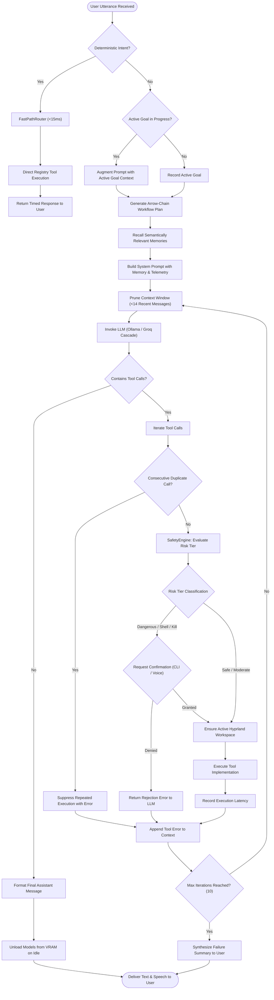

# Project J.A.R.V.I.S. – System Architecture

> **Just A Rather Very Intelligent System**  
> An autonomous desktop AI agent designed for Linux/Wayland environments to perceive screen state, control input devices, manage applications, run system workflows, and communicate through natural voice.

---

## 1. High-Level System Architecture

The following flowchart illustrates the end-to-end architecture of the J.A.R.V.I.S. ecosystem, spanning **Sensory Ingestion**, **Cognitive Reasoning & Planning**, **Safety Gates**, and **Effectors & Environmental Control**.

```mermaid
flowchart TD
    %% User Inputs & Ingestion
    subgraph Inputs ["1. Input Interfaces & Senses"]
        UserCLI["Terminal CLI (Rich UI / Prompts)"]
        MicIn["Microphone Audio Stream"]
        WakeWord["Wake-Word Detector ('Jarvis' / 'Hey Jarvis')"]
        VAD["Voice Activity Detection (RMS Energy / Silence Cutoff)"]
        WhisperSTT["Whisper STT (Groq Turbo / OpenAI)"]
        ScreenFeed["Wayland/Hyprland Display (grim / RAM Disk)"]
        SysMetrics["Linux Telemetry (psutil / PipeWire / Network)"]
    end

    MicIn --> WakeWord
    WakeWord --> VAD
    VAD --> WhisperSTT

    %% Reflex vs Cognitive Routing
    subgraph Routing ["2. Ingestion & Fast-Path Routing"]
        InputDispatcher{"Intent Classification & Dispatch"}
        FastPath["FastPath Reflex Router (<15ms Regex Match)"]
        ReflexExec["Direct Tool Reflex (Time, Mute, Volume, Telemetry)"]
    end

    UserCLI --> InputDispatcher
    WhisperSTT --> InputDispatcher
    InputDispatcher -- "Deterministic Match" --> FastPath
    FastPath --> ReflexExec
    InputDispatcher -- "Complex / Unknown Goal" --> ReActEngine

    %% Cognitive Core
    subgraph CognitiveCore ["3. Cognitive Core (Brain)"]
        ReActEngine["Jarvis Agent Orchestrator (ReAct Loop)"]
        PlanGenerator["Arrow-Chain Workflow Planner"]
        ContextPruner["Context Pruner (TPM / Token Window Manager)"]
        PromptBuilder["Prompt Builder (Persona + Recalled Facts)"]
        LLMClient["LLM Multi-Provider Client"]
        ModelManager["Ollama VRAM Lifecycle Manager"]
        MemoryBank[("Persistent Memory Store (Atomic JSON + Profile)")]
    end

    ReActEngine --> PlanGenerator
    ReActEngine <--> MemoryBank
    ReActEngine --> PromptBuilder
    PromptBuilder --> ContextPruner
    ContextPruner --> LLMClient
    LLMClient <--> ModelManager

    %% Model Providers
    subgraph ModelPool ["4. Neural Inference Engines"]
        OllamaLocal["Local Ollama GPU (qwen3:4b Reasoning)"]
        OllamaVLM["Local Ollama GPU (qwen2.5vl:3b Vision)"]
        GroqCascade["Groq Free-Tier Cascade (gpt-oss-120b / qwen3.8-27b)"]
    end

    LLMClient --> OllamaLocal
    LLMClient --> GroqCascade

    %% Safety & Authorization
    subgraph SafetyGate ["5. Safety Engine & Guardrails"]
        RiskClassifier{"Risk Tier Classifier"}
        TierSafe["SAFE: Telemetry, Read-Only, Captures"]
        TierModerate["MODERATE: App Launch, Volume, Writes"]
        TierDangerous["DANGEROUS: Shell Execution, Deletion, Kill"]
        ConfirmPrompt{"User Authorization Gate (Voice / CLI Prompt)"}
    end

    ReActEngine -- "Tool Call Request" --> RiskClassifier
    RiskClassifier --> TierSafe
    RiskClassifier --> TierModerate
    RiskClassifier --> TierDangerous
    TierSafe --> ToolRegistry
    TierModerate --> ToolRegistry
    TierDangerous --> ConfirmPrompt
    ConfirmPrompt -- "Approved" --> ToolRegistry
    ConfirmPrompt -- "Rejected" --> ReActEngine

    %% Tool Registry & Domain Toolsets
    subgraph ToolRegistry ["6. Active Tool Registry"]
        AppTools["App Control (hyprctl, gio, xdg-open)"]
        FileTools["File Operations (Read, Edit Diff, Trash)"]
        ShellTools["Shell Runner (Sandboxed Bash Execution)"]
        DOMTools["Browser DOM Driver (Playwright Chrome Driver)"]
        SysTools["System Controls (Volume, Brightness, Notifications)"]
        NavTools["Closed-Loop Screen Navigator"]
    end

    %% Effectors & Desktop Interaction
    subgraph Effectors ["7. Hands & Effectors (Execution)"]
        WorkspaceMgr["Hyprland Workspace Manager"]
        WaylandPointer["Native Wayland Pointer (C WLR Protocol Bin)"]
        PyAutoGUI["Keyboard & Mouse Automation (XKB Keymap)"]
        TTS["Edge-TTS Synthesis Engine (en-GB-RyanNeural)"]
        AudioOut["Audio Playback (pw-play / ffplay / paplay)"]
    end

    NavTools --> WorkspaceMgr
    NavTools --> WaylandPointer
    NavTools --> PyAutoGUI
    ReflexExec --> AudioOut
    ReActEngine --> TTS
    TTS --> AudioOut

    %% Feedback Loop
    subgraph VisionPipeline ["8. Visual Perception & Verification (Eyes)"]
        GrimCapture["Screen Capture Engine (grim /dev/shm)"]
        GroundingEngine["Vision Grounding Engine (Coordinate Mapping)"]
        VisualDiff["Visual Diff Engine (State Change Detection)"]
    end

    ScreenFeed --> GrimCapture
    GrimCapture --> GroundingEngine
    GroundingEngine <--> OllamaVLM
    GroundingEngine --> NavTools
    WaylandPointer -. "Action Dispatched" .-> ScreenFeed
    GrimCapture --> VisualDiff
    VisualDiff -. "Verification Feedback" .-> NavTools
```

---

## 2. ReAct Cognitive Loop & Decision Pipeline

The central reasoning engine executes an iterative **Reason + Act** cycle with context pruning, tool deduplication, and feedback collection.

---

## 3. Closed-Loop GUI "Computer Use" Workflow

For graphical user interface automation, J.A.R.V.I.S. employs a closed-loop **Observe ➔ Locate ➔ Act ➔ Verify** pipeline.

```mermaid
flowchart LR
    subgraph Step1 ["1. Observe"]
        Capture["grim Screen Capture"]
        RAMDisk["Save to /dev/shm (Zero Disk I/O)"]
        Capture --> RAMDisk
    end

    subgraph Step2 ["2. Locate"]
        VLM["Qwen 2.5-VL / Cloud VLM"]
        CoordParser["Extract Bounding Box [ymin, xmin, ymax, xmax]"]
        NormToPixel["Map Normalized Coords to Pixel (X, Y)"]
        RAMDisk --> VLM
        VLM --> CoordParser
        CoordParser --> NormToPixel
    end

    subgraph Step3 ["3. Act"]
        FocusWS["Switch Hyprland Workspace"]
        SmoothMove["Move Cursor (Bezier Trajectory)"]
        PointerDispatch["Dispatch Click (wayland_pointer / pyuserinput)"]
        NormToPixel --> FocusWS
        FocusWS --> SmoothMove
        SmoothMove --> PointerDispatch
    end

    subgraph Step4 ["4. Verify"]
        PostCapture["Post-Action Screenshot"]
        DiffEngine["Visual Diff Engine (Pixel & Structural Diff)"]
        StateCheck{"UI Changed?"}
        PointerDispatch --> PostCapture
        PostCapture --> DiffEngine
        DiffEngine --> StateCheck
    end

    StateCheck -- Yes --> SuccessOutcome(["Action Confirmed Successful"])
    StateCheck -- No --> Recover(["Report Unchanged UI / Retry Coordinates"])
```

---

## 4. Subsystem Breakdown & Tech Stack

| Subsystem | Key Modules | Primary Technologies | Key Functions & Responsibilities |
|---|---|---|---|
| **Voice In** | `voice/wake_word.py` `voice/listener.py` | PipeWire (`pw-record`), Groq Whisper Large v3 Turbo, RMS Energy VAD | Wake-word detection ("Jarvis"), voice activity detection, streaming audio transcription (<300ms latency). |
| **Voice Out** | `voice/speaker.py` | Microsoft Edge-TTS (`en-GB-RyanNeural`), `pw-play` / `ffplay` | British gentleman speech synthesis, streaming sentence pipelining, instant barge-in cut-off. |
| **Cognitive Core** | `core/agent.py` `core/fast_path.py` `core/prompts.py` | Python 3, Pydantic, Custom ReAct Loop, Arrow Plan Generator | Orchestrates reasoning, maintains active goal tracking, token context pruning, reflex execution routing. |
| **Model Manager** | `core/model_manager.py` `core/llm_client.py` | Local Ollama API, Groq SDK, OpenAI SDK | Round-robin API key fallback, VRAM residency management (exclusive loading, auto-unload on idle). |
| **Perception (Vision)** | `vision/capture.py` `vision/grounding.py` `vision/analyzer.py` `vision/visual_diff.py` | `grim` (Wayland), PIL, Qwen 2.5-VL, Image Diffing | Zero-disk-I/O RAM screenshot capture, visual element coordinate grounding, UI change verification. |
| **GUI Automation** | `gui_driver/navigator.py` `gui_driver/mouse_keyboard.py` `core/workspace.py` | Wayland `wlr-virtual-pointer`, PyAutoGUI, `hyprctl` | Smooth cursor motion, Wayland C pointer clicks, keyboard shortcuts, workspace isolation. |
| **Browser DOM** | `tools/browser_dom.py` | Playwright, Google Chrome Headless/Headed | Sub-15ms DOM inspection, element query, text entry, and link traversal without vision overhead. |
| **Safety Engine** | `core/safety.py` | Python Regex, Risk Tiers (`SAFE`, `MODERATE`, `DANGEROUS`) | Block dangerous shell patterns (fork bombs, `rm -rf /`), gate destructive actions behind user confirmation. |
| **Persistent Memory** | `memory/store.py` `tools/memory_ops.py` | Atomic JSON Storage, Semantic Keyword Scoring | Cross-session user preferences, profile attributes, conversation facts, and proactive prompt context. |
| **System Tools** | `tools/app_control.py` `tools/file_ops.py` `tools/system_ctl.py` `tools/system_info.py` | `hyprctl`, `psutil`, `gio`, `xdg-open`, `notify-send`, PipeWire | Launch/focus apps via Hyprland, safe file edits with diff preview, audio volume, hardware telemetry. |

---

## 5. Architectural Invariants & Design Principles

1. **Local-First & Resource-Mindful**:
   - Primary reasoning and vision default to local GPU models (`qwen3:4b` and `qwen2.5vl:3b`) via Ollama.
   - `OllamaModelManager` guarantees mutual exclusivity between reasoning and vision models to prevent VRAM competition, thermal throttling, and OOM panics on laptop GPUs.
   - Auto-unloads models on idle to keep systems quiet and cool.

2. **Ultra-Low Latency Dual-Track Processing**:
   - **Track 1 (Fast-Path Reflex)**: Deterministic, regex-matched commands execute directly in `<15ms`, bypassing LLM round-trips entirely.
   - **Track 2 (Cognitive ReAct)**: Complex, exploratory tasks run through the multi-turn ReAct loop with arrow-chain workflow pre-planning.

3. **Closed-Loop Verification**:
   - GUI operations do not fire-and-forget; they verify state changes using pre- and post-action visual frame comparisons.

4. **Multi-Tiered Safety Guardrails**:
   - Destructive operations (`safe_delete_file`, `terminate_process`, `execute_shell_command`) are gated by explicit interactive confirmation (CLI `y/N` or Voice `yes/no`).
   - Critical catastrophic commands (fork bombs, direct drive writes) are intercepted and permanently blocked at the safety engine level.
